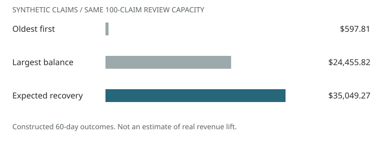

# Which claim gets worked next?

A denial-work review that counts expected recovery, the cost of working a claim, and the evidence behind a proposed correction.

[Open the report](https://rhasan55.github.io/claims-review/) · [SQL](panel.sql) · [Analysis](analysis.py)



In this case, selecting by expected recovery works more paid claims within the same review capacity. A large balance alone does not tell a biller how likely it is to be recovered.

All observations and policy passages are simulated. This is not an estimate of Red Sky Health's results. The question came from its public role covering denial prediction, score calibration and auditable LLM recommendations. [Context](sources.md)

## What changes the answer

The report compares three queues over the same held-out cohort, with 100 claims reviewed at $20 each:

| Selection rule | Recovery after review cost | Interpretation |
| --- | ---: | --- |
| Oldest first | $597.81 | Work the claims that have waited longest. |
| Largest balance | $24,455.82 | Prioritize the largest allowed amounts. |
| Expected recovery | $35,049.27 | Account for recovery probability as well as amount. |

Amounts are USD from constructed, fully observed 60-day outcomes. These comparisons demonstrate the accounting; they do not establish causal revenue lift or real-world model accuracy. The evidence panel separately shows why a proposed correction must be held when its policy or source value does not match.

## Reproduce

```bash
python -m venv .venv
source .venv/bin/activate
pip install -r requirements.txt
OMP_NUM_THREADS=1 python analysis.py
python evidence.py
python ledger.py
python -m unittest -v test_analysis.py
python build_report.py
```

Python 3.12; dependencies are pinned. Seed 55 reproduces the displayed values. You can open `index.html` directly without installing anything.

`panel.sql` runs a point-in-time join over normalized synthetic events, including replayed payments and reversals. `warehouse.sql` gives its SQL Server integration counterpart. The Python analysis trains a gradient-boosted model, fits its calibration map on a separate period, and evaluates only after those labels have matured. `evidence.py` checks structured candidate outputs against payer, plan, policy date and source evidence.

This is a small local example, not a production claims system. The SQL sketch is not warehouse-tested, and the evidence cases are fixed fixtures, not live LLM outputs. Real use needs biller adjudication, policy retrieval evaluation and a prospective test of recovery.

[Methods](methods.md) · [Checks and development notes](analysis-audit.md) · [Test output](test-results.txt)
